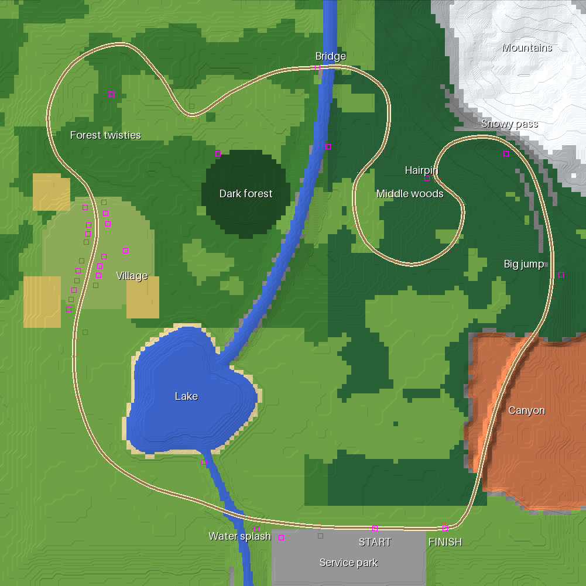

# tc-rally_game

A rally game for DiamondFire, written in
[Terracotta](https://github.com/Owlfroggy/terracotta). The cars are built from
separate parts, so they can be damaged and broken apart.

## Layout

| Path | Contents |
| --- | --- |
| [car/](car/) | Car design: [README](car/README.md), [part list](car/PARTS.md), `parts.json` for the game code |
| [pack/](pack/) | Resource pack (Minecraft 26.3, format 97.1), namespace `rally` |
| [pack/src/car_parts.py](pack/src/car_parts.py) | Generates the car models, textures and part data |
| [tc/](tc/) | Terracotta code for the plot (206003, Mega): pack, commands, car spawning; `car_data.tc` is generated |
| [pack/src/engine_sound.py](pack/src/engine_sound.py) | Synthesizes the engine sound loops |
| [tools/build_pack.py](tools/build_pack.py) | Validates, zips and publishes the pack to the `pack-dist` branch |
| [tools/viewer/](tools/viewer/) | 3D viewer for the car models |
| [map/gen_map.py](map/gen_map.py) | Designs the rally map and writes `tc/map_data.tc` and [map/preview.png](map/preview.png) |

## Build the car

```bash
python3 pack/src/car_parts.py
```

Needs Python 3 with Pillow. It rewrites the files under
`pack/assets/rally/`, `car/parts.json`, `car/PARTS.md` and
`tools/viewer/car_data.js`.

## Publish the pack

```bash
python3 tools/build_pack.py --publish --push
```

Then put the printed URL in `packUrl()` in `tc/pack.tc` and send the code.

## In game

| Command | Effect |
| --- | --- |
| `@start` | Put a car before the stage start line with you in it; the clock runs from the start line to the finish |
| `@map build [X0 Z0 X1 Z1]` | Build the whole map (or only that plot-space area); `@map terrain\|road\|structs\|props\|decor\|wipe [area]` builds one phase, `@map stop` stops |
| `@tp X Y Z [YAW [PITCH]]` | Teleport in plot space (what the code uses: x and z from the plot corner) |
| `@tpa X Y Z [YAW [PITCH]]` | Teleport to absolute (F3) coordinates; `@origin X Y Z` with your F3 position sets the plot origin first |
| `@tpr DX DY DZ [DYAW [DPITCH]]` | Teleport relative, world axes |
| `@tpf FWD [UP [RIGHT]]` | Teleport relative to where you look |
| `@look YAW [PITCH]`, `@where` | Turn on the spot; show plot and absolute position |
| `@spec`, `@fly`, `@walk` | Spectator, creative flying, adventure |
| `@car [turn]` | Spawn a car 6 blocks ahead, facing your way turned by `turn` degrees |
| `@drive` | Get in the nearest free car within 8 blocks |
| `@exit` | Get out (same as F) |
| `@tune [name value \| reset]` | Show or set physics tunables: spring, damper, grip, power, brake, steer, lat, links |
| `@dbg` | Toggle the physics debug readout in the action bar |
| `@damage` | List the damaged parts of your car (or the nearest) |
| `@hit PART AMOUNT` | Damage one part, e.g. `@hit bumper_f 50` (ids in [car/PARTS.md](car/PARTS.md)) |
| `@track build` | Build the rally test track with its start line at your feet, heading your way (about 85 x 70 blocks) |
| `@track clear` | Put grass back over the track's footprint |
| `@fix` | Repair your car (or the nearest): fresh parts, full HP, back on its wheels |
| `@part <id> [turn]` | Spawn one part only, to check its model |
| `@carcheck` | List the newest car's parts that have no display |
| `@clearcars` | Remove every car |
| `@pack` | Send the resource pack again |

## The map

The plot (206003, Mega) is a 1001 x 1001 block rally map: plot x and z
0..1000 (absolute x 100000.., z 4000..), ground at y 49, build limit 255.
`map/gen_map.py` designs it (needs numpy, scipy and Pillow):

```bash
python3 map/gen_map.py
```



**SS1 Kestrel Ridge**, a 3.4 km loop. From the service park it runs west
along the start straight and through a water splash in the creek, then
round the lake on dirt and north through the village on asphalt. Forest
twisties with a crest jump follow, then a wooden bridge over the river,
the middle woods and a rocky climb with a hairpin. The road crosses a snowy
pass under the north-east mountains, takes the big jump on the descent and
goes through a terracotta canyon. Gravel brings it back to the flying
finish. Hay bales line the bends, with red and white marker posts, chevron
boards at the hairpins, kilometre signs, and spectator stands at the splash,
the jumps and the hairpins.

The plot code (`tc/map.tc`, `tc/map_build.tc`) builds it from compact data:
terrain heights every 8 blocks (interpolated exactly the same way in both
places), one surface letter per 8 x 8 cell (meadow, oak and spruce forest,
dark forest, rock, snow, canyon, lake bed, farm, village), the road every
3 blocks, the props and the structures. It works a few rows or road
stamps per tick and slows down when the plot CPU rises. Trees are
Minecraft's own (Generate Tree). `@map build` takes about 20 minutes on a
Mega plot (the client gets few chunk updates while it runs); run
`@map wipe` first to rebuild over an old build. `@map road` also rebuilds
the structures and props, because the road clears 6 blocks each side.
Players join and respawn at the service park, since the plot spawn is
inside the hills at the map edge.

`tc/stage.tc` times the stage: the clock starts at the start line and
stops at the finish line, with split checkpoints along the road that must
be passed in order. The HUD shows the stage time, and the best time is
saved.

## Driving

W throttle, S brake (reverse once stopped), A/D steer, hold Shift for the
handbrake, F to get out, Q to put the car back on its wheels. The action bar
shows speed, gear, rpm and plot CPU.

The physics (`tc/physics.tc`) is one rigid body per car, stepped once per
tick: ray-cast spring-damper suspension per wheel, tires capped by a friction
circle that depends on the surface block, a torque curve with a six-speed
automatic and 40/60 four-wheel drive, and probe points that push the body out
of blocks. Each wheel samples the ground under the hub and 0.45 m ahead and
behind, so a step ahead reads as a ramp and the car climbs half-block slabs;
body probes ride up onto anything with free space 0.6 m above it and only
stop at full-height walls. All rigid parts share one display matrix (`tc/render.tc`), so a
driven car costs about 5% plot CPU.

DiamondFire numbers keep 3 decimals, so the physics works per unit mass
(accelerations) and never multiplies by 1 / mass.

## Damage

`tc/damage.tc`. The strongest body hit of a tick above 3 m/s damages the
parts whose hitbox is near the contact point; a part whose shields are also
there and still on is protected (bumper before radiator, hood before engine),
and the chassis takes a share of every hit. Slamming a wheel into its bump
stop damages that spring and arm. Below 60% HP a part shows its damaged
model. At 0 HP a part that comes off breaks away with everything it carries
as tumbling debris; the others fail in place. Effects: engine power, lost top
gears, axles or single wheels without drive, softer springs, punctured tires,
missing wheels, and an engine that overheats without its radiator and smokes
when hurt.

## Engine sound

The engine is a procedural 2.0 turbo inline-4, synthesized offline by
`pack/src/engine_sound.py`: one combustion pulse fired twice per crank
revolution in I4 order (1-3-4-2) with per-cylinder imbalance and jitter,
through an exhaust filter and pipe resonances, with crank hum, valvetrain
tick and turbo whistle. The result is one short clip of whole 4-cylinder
cycles. In game (`tc/sound.tc`) the driven car plays it every tick, pitched
to the exact rpm; the copies overlap, so the pitch follows the rpm smoothly.
Minecraft clamps pitch to 0.5..2, and pitching far also drags the exhaust
tone up, so the same cycle is baked at 1300, 2900 and 5800 rpm and
crossfaded at 1900 and 4100 rpm (no clip is pitched more than about 45%). Off throttle it is quieter, with random
anti-lag pops above 3500 rpm.

To change what each combustion ("explosion") sounds like, give it any WAV:

```bash
python3 pack/src/engine_sound.py --pulse my_bang.wav --preview build/engine_sweep.wav
```

`--preview` also writes a rev sweep to listen to. Then publish the pack.

## View the car

```bash
python3 -m http.server 8765 --directory tools/viewer
```

Then open http://localhost:8765. Drag to orbit. Click a part for its data, and
double-click it to break it off. The controls explode the car, show the
damaged models, ghost the body to show the mechanics, and change the paint and
accent colors.
